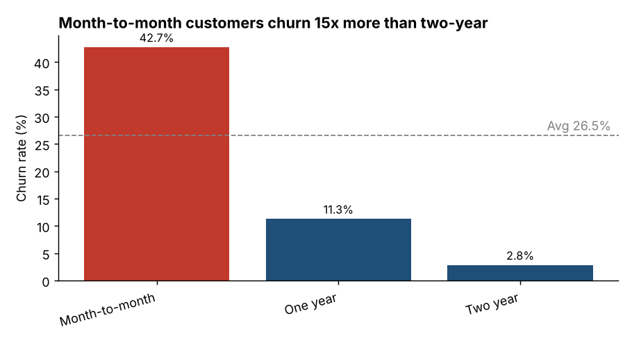
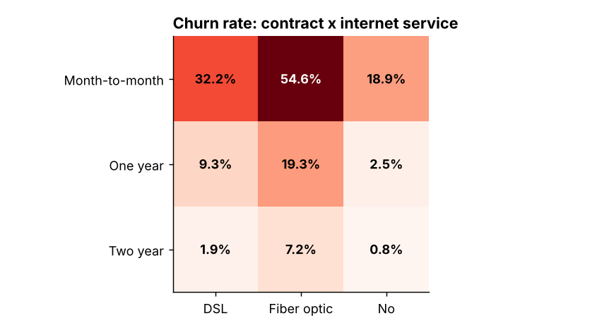
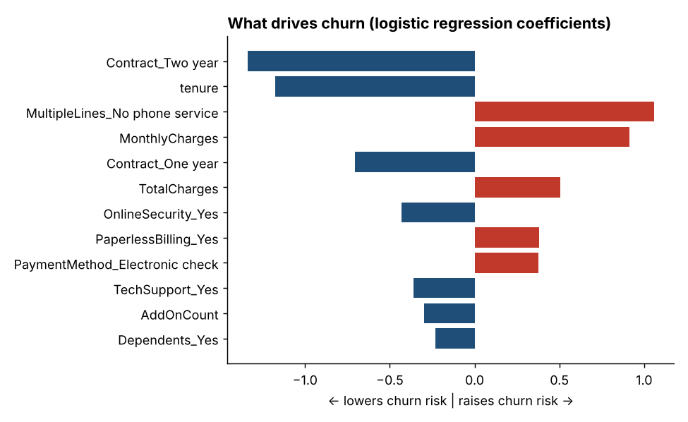

# Telecom Customer Churn Analysis

**Business question:** Who is leaving, why, and how much revenue is it costing us? Where should the retention team focus first?

**Tools:** Python (pandas, NumPy, SciPy, scikit-learn, matplotlib) · SQL (SQLite) · Tableau

**Data:** IBM Telco Customer Churn dataset, 7,043 customers, 21 fields (public sample dataset).

---

## Key findings

| # | Finding | Evidence |
|---|---------|----------|
| 1 | **26.5% of customers churned**, taking **$139K of monthly recurring revenue (30.5%)** with them | 1,869 of 7,043 customers |
| 2 | **One segment drives most of the loss:** month-to-month fiber customers are 30% of the base but **72% of lost revenue** | Churn rate 54.6% (2,128 customers) |
| 3 | **Contract type is the strongest driver:** month-to-month churn is 42.7% vs 2.8% on two-year contracts (about 15x) | Chi-square, Cramer's V = 0.41, p < 0.001 |
| 4 | **The first year is the danger zone:** 47% of customers with 0-12 months tenure churn vs 9.5% after 4 years | Tenure group analysis |
| 5 | **Electronic-check payers churn at 45%** vs about 15-17% for automatic payment methods | Payment method analysis |
| 6 | **Add-on services protect:** customers with 0 add-ons churn at 52% vs 21% with 3+ add-ons | Add-on bucket analysis |
| 7 | **Gender has no effect** (p = 0.49) | Chi-square test |




## Model

Logistic regression (class-balanced) predicts churn with **AUC 0.85** and **80% recall** on a held-out 25% test set (precision 51%, which is an acceptable trade-off when the cost of a retention offer is low compared with the lost customer).
Gradient boosting scored the same AUC, so the simpler, explainable model was kept.

**Targeting efficiency:** contacting the riskiest 30% of customers reaches **67% of all churners** (`images/gains_curve.png`).



## Recommendations

1. **Convert month-to-month fiber customers to 1-year contracts** with a discount or free add-on. If only 15% of the at-risk group is saved, that is about **$15K/month, or roughly $181K/year**, in retained revenue.
2. **Build a first-year onboarding programme** (check-in at months 1, 3, 6), since nearly half of all churn happens here.
3. **Push autopay enrolment** for electronic-check customers (small bill credit).
4. **Bundle Online Security and Tech Support** for customers with 0-2 add-ons. Both are associated with significantly lower churn.
5. Use `ChurnProbability` / `RiskTier` in the Tableau export to give the retention team a ranked call list (SQL Q9 gives a ready target list).

## Limitations (be honest about these in interviews)

- Data is a **single snapshot**, so there is no true time-series cohort analysis. The SQL retention view groups customers by tenure instead.
- Findings are **associations, not proof of cause**. An A/B test of the contract offer would be the real validation.
- The 15% save rate is an **assumption**, not an observed value. Change it in `03_analysis_and_model.py`.
- Risk scores in the Tableau file come from a model fit on all customers (for dashboarding). Model accuracy figures above come from the separate held-out test set.
- `MultipleLines_No phone service` appears as a large coefficient because it overlaps with DSL-only customers (multicollinearity), so don't read it as a standalone driver.

## Project structure

```
data/        raw CSV, cleaned CSV, SQLite database
sql/         analysis_queries.sql  (9 queries: aggregation, CTEs, window functions)
src/         01 clean+load  02 run SQL  03 analysis+model
outputs/     query results, chi-square tests, odds ratios, model metrics, business impact
images/      charts used in this README
tableau/     Tableau-ready CSV + TABLEAU_GUIDE.md (step-by-step dashboard build)
```

## Run it

```bash
./run_all.sh        # or run the three scripts in src/ in order
```

## SQL skills demonstrated
Aggregations and `GROUP BY`/`HAVING`, `CASE WHEN` bucketing, CTEs, window functions (`SUM() OVER`, `RANK()`, running cumulative %), Pareto analysis, target-list queries.
